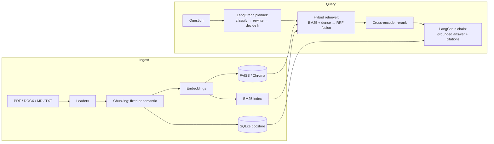

# Enterprise Knowledge Intelligence

An **advanced RAG** system that answers questions over enterprise documents — with hybrid retrieval, cross-encoder reranking, LangGraph query planning, and **citations on every answer**.

Built with Python, FastAPI, LangChain, LangGraph, FAISS, and DeepEval-style evaluation. It runs **fully offline** out of the box (deterministic fake embeddings + an extractive mock LLM), and upgrades to OpenAI or local Hugging Face models with two environment variables.

## What it does

| Capability | How |
|---|---|
| **Ingestion** | PDF, DOCX, Markdown, plain text — fixed-size chunking (sentence-aware) or semantic chunking |
| **Retrieval** | Hybrid: BM25 keyword search + dense FAISS vectors, fused by Reciprocal Rank Fusion |
| **Reranking** | Cross-encoder (`ms-marco-MiniLM-L-6-v2`) re-scores the fused candidates |
| **Planning** | LangGraph state machine classifies the question (factual / summary / comparison / multi-hop), rewrites it, and picks retrieval depth |
| **Generation** | LangChain chain; the model answers **only** from retrieved context and cites every claim as `[1]`, `[2]` … |
| **Evaluation** | Precision@k / Recall@k / MRR / faithfulness harness with a sample eval set (DeepEval metrics plug in automatically when installed) |
| **API** | FastAPI: `/ingest`, `/query`, `/documents`, `/health` + OpenAPI docs at `/docs` |
| **UI** | Single-page demo UI at `/` — upload docs, ask questions, see citations |
| **CLI** | `python -m eki.cli ingest <folder>` / `ask "<question>"` / `stats` / `serve` |

## Architecture



**Query flow:** the planner classifies the question and rewrites it (multi-hop and comparison questions are split into sub-questions and fetch deeper). The hybrid retriever pulls top-k from FAISS and top-k from BM25, fuses them with RRF, and the cross-encoder reranks the fused list. The generator answers only from the reranked context, with `[n]` citations resolved to source documents. If the model cites nothing, the retrieved sources are attached anyway — an answer is never presented without provenance.

**Storage:** SQLite is the source of truth (documents, chunks, embeddings). The FAISS index and BM25 index are derived from it and rebuilt on startup, so they can never drift out of sync.

## Quickstart

```bash
python -m venv .venv && source .venv/bin/activate
pip install -r requirements.txt
pip install -e .            # makes the `eki` command available

# Ingest the sample policies and ask a question (offline, no API key)
python -m eki.cli ingest docs/sample
python -m eki.cli ask "How many days per week can employees work remotely?"
# → Employees may work remotely up to three days per week. [1]
#   Sources: [1] remote-work-policy

# Start the API + UI
python -m eki.cli serve
# open http://127.0.0.1:8000  (UI)  and  /docs (OpenAPI)
```

## API reference

| Method | Endpoint | Description |
|---|---|---|
| `GET` | `/health` | Liveness + index stats (docs, chunks, providers) |
| `GET` | `/` | Demo UI |
| `POST` | `/ingest` | Multipart file upload (PDF / DOCX / MD / TXT) |
| `POST` | `/ingest/text` | `{"title", "text", "source?", "metadata?"}` |
| `POST` | `/query` | `{"question", "top_k?", "filters?"}` → `{answer, citations, query_plan, latency_ms, retrieved_count}` |
| `GET` | `/documents` | List indexed documents |
| `DELETE` | `/documents/{doc_id}` | Remove a document and its chunks from every index |

`filters` is a metadata match, e.g. `{"file_type": ".pdf"}` or `{"doc_id": "..."}`.

## Configuration

Copy `.env.example` to `.env`. Every setting is an environment variable; no secret ever lives in code.

| Variable | Default | Notes |
|---|---|---|
| `EKI_EMBEDDING_PROVIDER` | `fake` | `fake` (offline) · `huggingface` · `openai` |
| `EKI_EMBEDDING_MODEL` | `sentence-transformers/all-MiniLM-L6-v2` | 384-dim MiniLM, or `text-embedding-3-small` for OpenAI |
| `EKI_LLM_PROVIDER` | `mock` | `mock` (offline, extractive) · `openai` · `huggingface` |
| `EKI_LLM_MODEL` | `gpt-4o-mini` | |
| `OPENAI_API_KEY` | — | Only needed for the `openai` providers |
| `EKI_CHUNK_SIZE` / `EKI_CHUNK_OVERLAP` | `800` / `120` | Fixed chunking |
| `EKI_CHUNKING_STRATEGY` | `fixed` | `fixed` · `semantic` |
| `EKI_TOP_K` / `EKI_RERANK_TOP_N` | `8` / `5` | Retrieval depth / final context size |
| `EKI_DENSE_WEIGHT` / `EKI_BM25_WEIGHT` | `0.6` / `0.4` | RRF fusion weights |
| `EKI_USE_RERANKER` | `true` | Cross-encoder reranking (needs the HF model; falls back gracefully offline) |
| `EKI_VECTOR_STORE` | `faiss` | `faiss` · `chroma` (needs `requirements-optional.txt`) |

**Using real models:**

```bash
pip install -r requirements-optional.txt   # sentence-transformers, chromadb, deepeval
export EKI_EMBEDDING_PROVIDER=huggingface
export EKI_LLM_PROVIDER=openai
export OPENAI_API_KEY=sk-...
```

## Evaluation

```bash
python scripts/run_eval.py
```

Runs the 8-question eval set in `eval_data/eval_set.json` against the sample docs and prints per-question plus aggregate metrics. Results are written to `eval_data/eval_results.json`.

**Latest run** (offline providers — fake embeddings + mock LLM, 2026-11-09):

| Metric | Score |
|---|---|
| Precision@5 | 0.875 |
| Recall@5 | 1.000 |
| MRR | 0.938 |
| Faithfulness (lexical groundedness) | 1.000 |

Faithfulness is the share of answer claims whose content words appear in the retrieved context. When DeepEval is installed and an LLM is configured, the harness delegates faithfulness to DeepEval's `FaithfulnessMetric` and reports that score instead.

## Tests

```bash
pytest
# 28 tests: chunking, retrieval (BM25 / RRF / hybrid), API endpoints, end-to-end pipeline + eval
```

## Docker

```bash
docker compose up --build
# API + UI at http://localhost:8000
```

The image is `python:3.12-slim` + `requirements.txt`; the index persists in the `eki-data` volume. Override providers with a `.env` file (see `.env.example`).

## Deployment options

- **Vector store:** FAISS is the default (local file). ChromaDB is a drop-in alternative (`EKI_VECTOR_STORE=chroma`). For Postgres, pgvector fits the same interface — run Postgres + pgvector and point the store at it.
- **Embeddings / LLM:** swap providers with two env vars; nothing else changes. The OpenAI path uses `text-embedding-3-small` / `gpt-4o-mini` by default.
- **Scaling:** the pipeline is stateless apart from the data directory, so the API can run behind any number of replicas sharing a volume (or a pgvector store).

## Roadmap

- [ ] Streaming answers (SSE) for the UI
- [ ] Conversational memory (multi-turn Q&A with history-aware retrieval)
- [ ] pgvector store implementation
- [ ] Document-level access control (per-user metadata filters)
- [ ] Agentic multi-hop: LangGraph loop that re-retrieves when groundedness is low
- [ ] Eval set expansion + DeepEval CI gate

## License

MIT — see `LICENSE`. Contributions welcome; see `CONTRIBUTING.md`.
